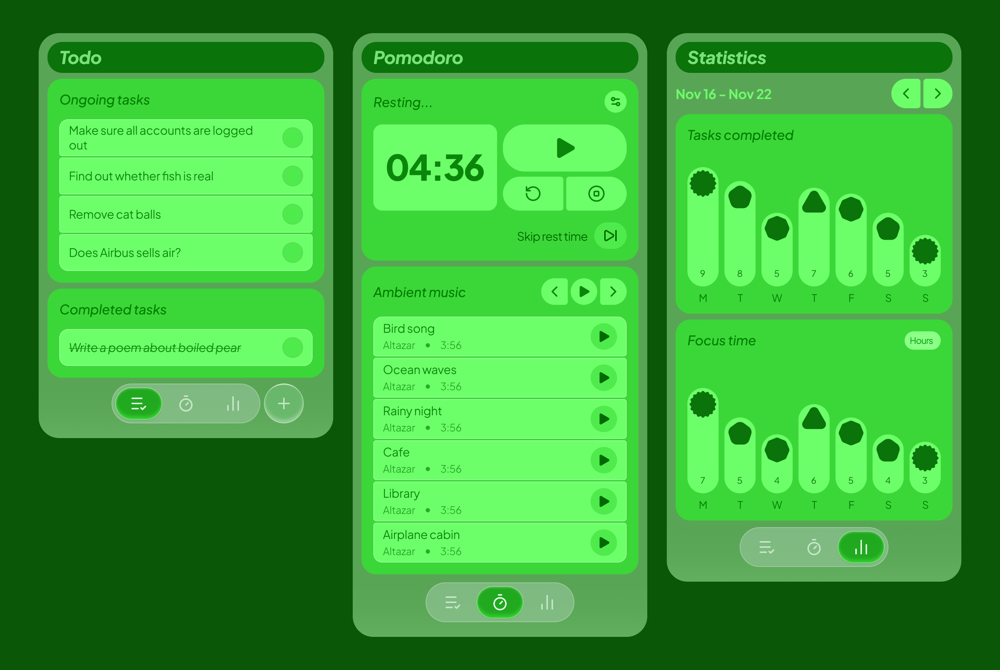

# Simple Todo

A sleek, minimalist desktop productivity app built with **Electron**, **React**, and **TypeScript**. Simple Todo combines an intuitive task manager with a focused **Pomodoro timer** and an infinite **ambient music player**.

---

## ✨ Features

- **Todo Management:**
  - Fast task creation with modal shortcuts (`Cmd/Ctrl + N`).
  - Tactile completion chimes and interactive checklist states.
  - Smooth swipe gestures to delete tasks.
  - Filter between active and completed tasks with local data persistence.

- **Pomodoro Timer:**
  - Customizable working sessions (`25`, `30`, `45`, `60` mins) and rest intervals (`5`, `10`, `15`, `20` mins).
  - Dedicated sound effect picker with 8 distinct synthesized chimes (Warm Chime, Tibetan Bowl, Soft Marimba, Gentle Harp, etc.).
  - Instant sound preview before saving preferences.
  - **Skip Rest** control to immediately jump back into focus mode.
  - Native macOS desktop notifications and un-throttled background timer precision when minimized.

- **Ambient Music Player:**
  - Integrated Lo-Fi / ambient soundtrack player that loops infinitely across playlists.
  - **Audio Ducking:** Automatically lowers the music volume when timer alarms and completion chimes ring, smoothly fading music back up when done.
  - Interactive playlist controls (Previous, Play/Pause, Next) with track selection.

---

## 🛠️ Tech Stack

- **Framework:** [Electron](https://www.electronjs.org/) + [electron-vite](https://electron-vite.org/)
- **UI & Styling:** [React 19](https://react.dev/), [Tailwind CSS v4](https://tailwindcss.com/)
- **State Management:** [Zustand](https://github.com/pmndrs/zustand) with local storage persistence
- **Animation:** [GSAP](https://gsap.com/)
- **Icons:** [Lucide React](https://lucide.dev/)
- **Audio:** Web Audio API & HTML5 Audio with real-time ducking

---

## 🚀 Getting Started

### Prerequisites

- [Node.js](https://nodejs.org/) (v18 or higher recommended)
- `npm`

### Installation

Clone the repository and install dependencies:

```bash
git clone https://github.com/your-username/electron-todo.git
cd electron-todo
npm install
```

### Running in Development

Start the app with Hot Module Replacement (HMR):

```bash
npm run dev
```

---

## 📦 Building Executables

Packages and installers are generated using [electron-builder](https://www.electron.build/) into the `dist/` directory.

### macOS (`.dmg`, `.app`, `.zip`)

To package a standalone `.app` and `.dmg` for macOS:

```bash
npm run build:mac
```

- **Output:** `dist/mac/Simple Todo.app` and `dist/Simple Todo-<version>.dmg`
- **Architecture:** Builds for your machine's current architecture (Apple Silicon `arm64` or Intel `x64`).

> [!NOTE]
> **Running on other Macs (macOS Gatekeeper):**  
> If you distribute the `.app` or `.dmg` to another Mac without code signing, macOS may display an _"Unidentified developer"_ warning. To open it:
>
> 1. Right-click the app in Finder and choose **Open**, then confirm **Open**.
> 2. Or run this terminal command:
>    ```bash
>    xattr -cr "/Applications/Simple Todo.app"
>    ```

### Windows (`.exe` Installer)

To package an NSIS setup executable for Windows:

```bash
npm run build:win
```

- **Output:** `dist/simple-todo-<version>-setup.exe`
- **Building from macOS/Linux:** Compiling Windows binaries directly from macOS requires [Wine](https://www.winehq.org/) (`brew install --cask wine-stable`), or building via Windows / GitHub Actions CI.

### Linux (`.AppImage`, `.deb`, `.snap`)

To package for Linux distributions:

```bash
npm run build:linux
```

- **Output:** `dist/simple-todo-<version>.AppImage` and `dist/simple-todo-<version>.deb`

### Unpacked Directory Build (Testing)

To quickly test the packaged output without building full disk images/installers:

```bash
npm run build:unpack
```

---

## 🎵 How to Add Your Own Music

You can customize the ambient soundtrack with your own audio files (`.mp3`, `.m4a`, `.wav`, or `.ogg`).

### 1. Add Audio Files

Place your music files into the assets directory:

```
src/renderer/src/assets/sounds/
├── my-track-1.mp3
└── my-track-2.mp3
```

> [!TIP]
> **File Size Recommendation:**  
> Use **`.mp3`** or **`.m4a`** (192 kbps or 256 kbps) instead of raw `.wav` files. Uncompressed WAV files will dramatically inflate your packaged app size (~40 MB per song vs ~3–5 MB for MP3/AAC).
>
> _On macOS, you can quickly convert any `.wav` to `.m4a` with the built-in terminal command:_
>
> ```bash
> afconvert -f m4af -d aac -b 192000 "song.wav" "song.m4a"
> ```

### 2. Register the Tracks in the Playlist

Open [`src/renderer/src/stores/use-ambient-sound-store.tsx`](file:///Users/samsul/Ree/Programming/electron-todo/src/renderer/src/stores/use-ambient-sound-store.tsx):

1. **Import your audio file:**

   ```ts
   import myTrack1 from '@renderer/assets/sounds/my-track-1.mp3'
   import myTrack2 from '@renderer/assets/sounds/my-track-2.mp3'
   ```

2. **Add it to `AMBIENT_PLAYLIST`:**
   ```ts
   export const AMBIENT_PLAYLIST: AmbientTrack[] = [
     {
       id: 'my-track-1',
       title: 'Peaceful Morning',
       artist: 'Artist Name',
       duration: '3:45',
       durationSeconds: parseDurationToSeconds('3:45'),
       src: myTrack1
     },
     {
       id: 'my-track-2',
       title: 'Deep Focus',
       artist: 'Artist Name',
       duration: '4:12',
       durationSeconds: parseDurationToSeconds('4:12'),
       src: myTrack2
     }
   ]
   ```

The playlist automatically calculates duration seconds, loops continuously, and ducks volume during timer alerts.

---

## 📄 License

This project is open source and available under the [MIT License](LICENSE).
